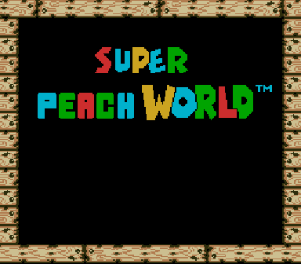

# Super Peach World

A graphics mod for [SuperMarioWorldRecomp](https://github.com/mstan/SuperMarioWorldRecomp) that turns Super Mario World into **Super Peach World**: Princess Peach replaces Mario, and the on-screen text and title banner follow.



> **No game data is included.** You need your own legally obtained Super Mario World (USA) ROM. This repo only contains scripts and a patch, never Nintendo's assets.

## What changes

- Mario's sprites (small and big) are replaced with Peach, including her palette.
- Fire Peach gets a white dress palette.
- Title banner reads **SUPER PEACH WORLD** (redrawn blocky "PEACH" letters).
- "MARIO" text in the status bar and course-clear screens becomes "PEACH".
- The "© 1990, 1991 Nintendo" line on the title screen is removed.
- Only graphics, palettes and text tiles are touched. No game code is modified.

## Install

### Option A: IPS patch

1. Get a clean `smw.sfc` (Super Mario World USA, headerless).
2. Apply `smw_peach.ips` with any IPS patcher (Floating IPS, Lunar IPS, etc.) to produce `smw_peach.sfc`.
3. Build SuperMarioWorldRecomp (see its README; on macOS use `build-macos.sh`).
4. Run the game with the patched ROM:

```bash
cd SuperMarioWorldRecomp/build
./SuperMarioWorldSNESRecomp ../smw_peach.sfc
```

### Option B: build from the scripts

Needs Python 3 and Pillow, a Peach sprite sheet in SMW format, and your stock ROM:

```bash
python tools/peach/build_peach.py --rom smw.sfc --sheet peach_sheet.png --out smw_peach.sfc --ips smw_peach.ips
```

`tools/peach/build_title.py` redraws the title logo and is called by the build script. `tools/peach/preview.py` renders an offline pose contact sheet.

## Notes and limitations

- The patched ROM has a different hash from the stock one, so the recomp's mod packages (which pin the stock hash) are skipped and the game starts without mods. This repo includes a small change in `src/main.c` so that this is no longer fatal.
- Some poses still show Mario's art recoloured in Peach colours: slope running, cape poses, hurt/star flash, and the wide end-of-level pose. See [`tools/peach/MISSING.md`](SuperMarioWorldRecomp/tools/peach/MISSING.md) for the list. Contributions of SMW-style frames are welcome.
- The "MARIO START !" screen text is not changed yet.
- The title logo uses only tiles unique to the old MARIO letters, because other tiles are shared with in-level graphics such as water.
- Luigi, star-flash and cape palettes were not checked.

## Credits

- Princess Peach sprites: **WizToad** and **GatetcVerde**, made for *Mario Worlds Delta* (Green Baron Games). Please credit them if you reuse the art.
- [mstan/SuperMarioWorldRecomp](https://github.com/mstan/SuperMarioWorldRecomp): the static recompilation this runs on.
- Super Mario World is a trademark of Nintendo. This is an unofficial fan project, not affiliated with or endorsed by Nintendo.
